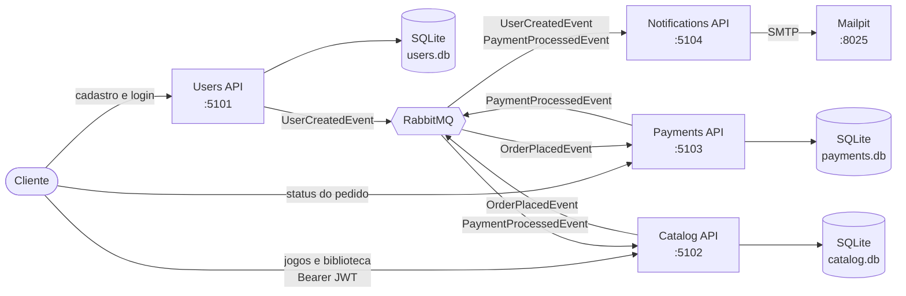
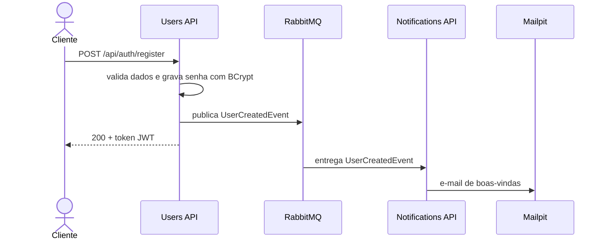
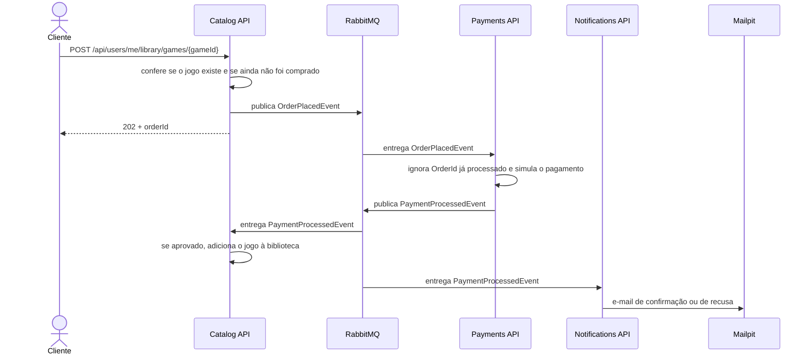

# FIAP Cloud Games — Tech Challenge Fase 2


**Pós Tech FIAP — Arquitetura de Sistemas .NET.** A FIAP Cloud Games (FCG) é uma plataforma de venda de jogos. Nesta fase, o monólito da Fase 1 foi dividido em **quatro microsserviços .NET 8** que se comunicam por **eventos no RabbitMQ**, cada um com seu próprio banco, imagem Docker e manifestos Kubernetes.

> **Sobre este repositório:** é a consolidação, em um único lugar, dos cinco repositórios entregues na Fase 2, com o histórico de commits e os autores originais preservados. Cada pasta de `fcg-*` corresponde a um dos [repositórios originais](#links-da-entrega) e tem o próprio README, com detalhes do serviço.

---

## Sumário

1. [Links da entrega](#links-da-entrega)
2. [O que esta fase entrega](#o-que-esta-fase-entrega)
3. [Arquitetura](#arquitetura)
4. [Fluxos principais](#fluxos-principais)
5. [Eventos](#eventos)
6. [Microsserviços e endpoints](#microsserviços-e-endpoints)
7. [Organização do repositório](#organização-do-repositório)
8. [Como executar](#como-executar)
9. [Roteiro de demonstração](#roteiro-de-demonstração)
10. [Configuração](#configuração)
11. [Escalabilidade](#escalabilidade)
12. [Decisões técnicas](#decisões-técnicas)
13. [Limitações conhecidas](#limitações-conhecidas)
14. [Tecnologias](#tecnologias)
15. [Equipe](#equipe)

---

## Links da entrega

| Item | Link |
|---|---|
| Vídeo de apresentação | [YouTube](https://youtu.be/viHs72kaWHU) |
| Diagrama — Arquitetura de microsserviços | [Miro](https://miro.com/app/board/uXjVH8LfCao=/) |
| Diagrama — Fluxo de cadastro | [Miro](https://miro.com/app/board/uXjVH8LlV2o=/) |
| Diagrama — Fluxo de compra | [Miro](https://miro.com/app/board/uXjVH8LfCbk=/) |

| Responsabilidade | Pasta neste repositório | Repositório original |
|---|---|---|
| Orquestração | [`fcg-platform`](fcg-platform) | [VHMoschini/fcg-platform](https://github.com/VHMoschini/fcg-platform) |
| Usuários | [`fcg-users-api`](fcg-users-api) | [VHMoschini/fcg-users-api](https://github.com/VHMoschini/fcg-users-api) |
| Catálogo | [`fcg-catalog-api`](fcg-catalog-api) | [VHMoschini/fcg-catalog-api](https://github.com/VHMoschini/fcg-catalog-api) |
| Pagamentos | [`fcg-payments-api`](fcg-payments-api) | [VHMoschini/fcg-payments-api](https://github.com/VHMoschini/fcg-payments-api) |
| Notificações | [`fcg-notifications-api`](fcg-notifications-api) | [VHMoschini/fcg-notifications-api](https://github.com/VHMoschini/fcg-notifications-api) |

> Os repositórios originais continuaram evoluindo depois da Fase 2 (Kong, MongoDB, Redis e observabilidade, da Fase 3). Este repositório traz apenas o estado da Fase 2.

---

## O que esta fase entrega

| Entrega | Como foi atendida | Onde ver |
|---|---|---|
| **Microsserviços** | Users, Catalog, Payments e Notifications, em .NET 8, com responsabilidades separadas | [`fcg-users-api`](fcg-users-api), [`fcg-catalog-api`](fcg-catalog-api), [`fcg-payments-api`](fcg-payments-api), [`fcg-notifications-api`](fcg-notifications-api) |
| **Mensageria assíncrona** | RabbitMQ com MassTransit e contratos de evento compartilhados | [`FCG.Messaging.Contracts`](fcg-users-api/FCG.Messaging.Contracts) |
| **Containers** | Dockerfile multi-stage por serviço | [`Users.Api/Dockerfile`](fcg-users-api/Users.Api/Dockerfile) |
| **Stack completa em um comando** | Docker Compose com RabbitMQ, Mailpit e as 4 APIs | [`docker-compose.yml`](fcg-platform/docker-compose.yml) |
| **Kubernetes** | Deployment, Service, ConfigMap e Secret por serviço, mais os manifestos de infraestrutura | [`fcg-users-api/k8s`](fcg-users-api/k8s), [`fcg-platform/k8s`](fcg-platform/k8s) |
| **Escalabilidade** | Overlay do Compose, exemplo de réplicas e HPA | [`ESCALABILIDADE.md`](fcg-platform/ESCALABILIDADE.md) |
| **Autenticação e perfis** | JWT emitido pela Users API e validado pela Catalog API; perfis `Usuario` e `Administrador` | [`JwtTokenGenerator.cs`](fcg-users-api/Users.Api/Infrastructure/Security/JwtTokenGenerator.cs) |
| **Idempotência** | Compra e pagamento toleram reentrega da mesma mensagem | [`OrderPlacedConsumer.cs`](fcg-payments-api/Payments.Api/Consumers/OrderPlacedConsumer.cs), [`LibraryService.cs`](fcg-catalog-api/Catalog.Api/Infrastructure/Services/LibraryService.cs) |

---

## Arquitetura



Os serviços não se chamam diretamente por HTTP: toda a integração passa pelo broker. A única dependência compartilhada em tempo de execução, além do RabbitMQ, é a **chave JWT**, que precisa ser igual em Users (emite) e Catalog (valida).

---

## Fluxos principais

### Cadastro



### Compra



A resposta `202 Accepted` indica que o pedido foi aceito, não que foi pago. O resultado é consultado em `GET /api/payments/orders/{orderId}` e aparece na biblioteca e no e-mail.

---

## Eventos

Definidos em `FCG.Messaging.Contracts`. Cada serviço carrega uma cópia desse projeto.

| Evento | Campos | Publicado por | Consumido por | Efeito |
|---|---|---|---|---|
| `UserCreatedEvent` | `UserId`, `Email`, `Name` | Users | Notifications | E-mail de boas-vindas |
| `OrderPlacedEvent` | `OrderId`, `UserId`, `GameId`, `Price`, `UserEmail` | Catalog | Payments | Processamento do pagamento simulado |
| `PaymentProcessedEvent` | `OrderId`, `UserId`, `GameId`, `Status`, `UserEmail` | Payments | Catalog, Notifications | Jogo na biblioteca, se aprovado; e-mail de confirmação ou recusa |

`Status` assume `Approved` ou `Rejected`.

---

## Microsserviços e endpoints

Respostas de erro usam o formato `{ "message": "..." }` nas APIs Users e Catalog: `400` para regra de negócio violada, `401` para credenciais inválidas e `404` para recurso inexistente.

### Users API — `:5101`

Cadastro, login e emissão do JWT. Em `Development`, cria o administrador de demonstração.

| Método | Rota | Acesso | Descrição |
|---|---|---|---|
| `POST` | `/api/auth/register` | Público | Cadastra o usuário, publica `UserCreatedEvent` e devolve o token |
| `POST` | `/api/auth/login` | Público | Autentica e devolve o token |

**Regras de senha:** mínimo de 8 caracteres, com pelo menos uma letra, um número e um caractere especial. O e-mail é normalizado em minúsculas e não pode se repetir.

### Catalog API — `:5102`

Catálogo de jogos e biblioteca do usuário.

| Método | Rota | Acesso | Descrição |
|---|---|---|---|
| `GET` | `/api/games` | Público | Lista os jogos ativos |
| `POST` | `/api/games` | Administrador | Cria um jogo |
| `PUT` | `/api/games/{id}` | Administrador | Atualiza um jogo |
| `DELETE` | `/api/games/{id}` | Administrador | Inativa um jogo |
| `POST` | `/api/games/{id}/reactivate` | Administrador | Reativa um jogo |
| `GET` | `/api/users/me/library` | Autenticado | Lista a biblioteca do usuário |
| `POST` | `/api/users/me/library/games/{gameId}` | Autenticado | Inicia a compra (`202` + `orderId`) |

### Payments API — `:5103`

Consome pedidos, simula o pagamento e publica o resultado.

| Método | Rota | Acesso | Descrição |
|---|---|---|---|
| `GET` | `/api/payments/simulation` | Público | Mostra a configuração da simulação |
| `GET` | `/api/payments/orders/{orderId}` | Público | Consulta o status de um pedido processado |
| `GET` | `/health` | Público | Verificação de saúde |

| Modo (`Payments__SimulationMode`) | Comportamento |
|---|---|
| `Random` (padrão) | Aprova com probabilidade `ApprovalRate` (padrão `0.92`); preços em `RejectPrices` (padrão `99.99`) são sempre recusados |
| `AlwaysApprove` | Sempre aprova |
| `AlwaysReject` | Sempre recusa |

### Notifications API — `:5104`

Consumidor de eventos que envia os e-mails por SMTP. Com `Smtp__Enabled=false`, apenas registra o envio no log.

| Método | Rota | Acesso | Descrição |
|---|---|---|---|
| `GET` | `/health` | Público | Verificação de saúde |

---

## Organização do repositório

```text
TC2/
├── README.md                     este guia
├── fcg-platform/                 orquestração, sem código de aplicação
│   ├── docker-compose.yml        RabbitMQ + Mailpit + 4 APIs
│   ├── docker-compose.scalability.yml
│   ├── build-images.ps1          builda as 4 imagens
│   ├── deploy-k8s.ps1            aplica ou remove tudo no cluster
│   ├── ESCALABILIDADE.md
│   ├── TESTE_PAGAMENTOS_MAILPIT.md
│   └── k8s/                      RabbitMQ, Mailpit e exemplos de escala
├── fcg-users-api/
├── fcg-catalog-api/
├── fcg-payments-api/
└── fcg-notifications-api/
```

Todas as APIs seguem a mesma estrutura:

```text
fcg-<serviço>-api/
├── <Serviço>.Api/                código e Dockerfile
├── FCG.Messaging.Contracts/      contratos de evento
├── k8s/                          Deployment, Service, ConfigMap e Secret
├── <Serviço>.Api.sln
└── README.md
```

> Os READMEs internos foram escritos para os repositórios separados e pedem que eles sejam clonados lado a lado. Aqui as pastas já estão nessa disposição, então basta clonar este repositório. Os scripts encontram as APIs sem precisar de `-ReposRoot`.

---

## Como executar

### Pré-requisitos

| Ferramenta | Necessária para |
|---|---|
| [Docker Desktop](https://www.docker.com/products/docker-desktop/) com Compose v2 | Docker e Kubernetes |
| PowerShell | Scripts `build-images.ps1` e `deploy-k8s.ps1` |
| `kubectl` e Kubernetes habilitado no Docker Desktop | Kubernetes |
| [.NET 8 SDK](https://dotnet.microsoft.com/download/dotnet/8.0) | Execução local, sem containers |

```powershell
git clone https://github.com/LMXSS/TC2.git
cd TC2\fcg-platform
```

### Opção 1 — Docker Compose

O Compose usa imagens locais (`pull_policy: never`), então é preciso buildá-las primeiro:

```powershell
.\build-images.ps1
docker compose up -d
docker compose ps
```

| Serviço | URL | Credenciais |
|---|---|---|
| Users API | http://localhost:5101/swagger | — |
| Catalog API | http://localhost:5102/swagger | — |
| Payments API | http://localhost:5103/swagger | — |
| Notifications API | http://localhost:5104/swagger | — |
| RabbitMQ | http://localhost:15672 | `guest` / `guest` |
| Mailpit | http://localhost:8025 | — |

Para acompanhar os eventos e encerrar:

```powershell
docker compose logs -f payments-api notifications-api
docker compose down      # adicione -v para apagar também os bancos
```

Sem PowerShell, builde as imagens manualmente, a partir da pasta de cada API:

```bash
(cd fcg-users-api         && docker build -f Users.Api/Dockerfile         -t fcg/users-api:latest .)
(cd fcg-catalog-api       && docker build -f Catalog.Api/Dockerfile       -t fcg/catalog-api:latest .)
(cd fcg-payments-api      && docker build -f Payments.Api/Dockerfile      -t fcg/payments-api:latest .)
(cd fcg-notifications-api && docker build -f Notifications.Api/Dockerfile -t fcg/notifications-api:latest .)
```

### Opção 2 — Kubernetes local

Com as imagens já buildadas:

```powershell
.\deploy-k8s.ps1
kubectl get pods
```

O script aplica primeiro o RabbitMQ e o Mailpit e depois a pasta `k8s/` de cada API. Os Services são `ClusterIP` na porta 80, então o acesso é por port-forward, um por terminal:

```powershell
kubectl port-forward svc/users-api 5101:80
kubectl port-forward svc/catalog-api 5102:80
kubectl port-forward svc/payments-api 5103:80
kubectl port-forward svc/mailpit 8025:8025
```

Para remover tudo: `.\deploy-k8s.ps1 -Delete`. No **Kind**, carregue as imagens antes com `kind load docker-image fcg/users-api:latest` (repita para as quatro).

### Opção 3 — Local com .NET SDK

Suba só a infraestrutura e rode cada API em um terminal, a partir da raiz do repositório:

```powershell
docker compose -f fcg-platform/docker-compose.yml up -d rabbitmq mailpit
dotnet run --project fcg-users-api/Users.Api
dotnet run --project fcg-catalog-api/Catalog.Api
dotnet run --project fcg-payments-api/Payments.Api
dotnet run --project fcg-notifications-api/Notifications.Api
```

As migrations são aplicadas automaticamente quando cada API sobe. As portas são as mesmas: 5101 a 5104.

---

## Roteiro de demonstração

O roteiro abaixo percorre os fluxos de cadastro e compra em PowerShell. O mesmo caminho pode ser feito pelo Swagger.

```powershell
$users    = "http://localhost:5101"
$catalog  = "http://localhost:5102"
$payments = "http://localhost:5103"
$json     = "application/json"

# 1. Login do administrador de demonstração
$admin = Invoke-RestMethod "$users/api/auth/login" -Method Post -ContentType $json `
  -Body '{"email":"admin@fcg.local","password":"Admin@123"}'

# 2. Criação de um jogo
$jogo = Invoke-RestMethod "$catalog/api/games" -Method Post -ContentType $json `
  -Headers @{ Authorization = "Bearer $($admin.token)" } `
  -Body '{"titulo":"Jogo Aprovado","genero":"RPG","preco":49.90}'

# 3. Cadastro de um usuário: o e-mail de boas-vindas chega ao Mailpit
$usuario = Invoke-RestMethod "$users/api/auth/register" -Method Post -ContentType $json `
  -Body '{"name":"Teste","email":"teste@fcg.local","password":"Senha@123"}'
$auth = @{ Authorization = "Bearer $($usuario.token)" }

# 4. Compra: responde 202 com o orderId
$pedido = Invoke-RestMethod "$catalog/api/users/me/library/games/$($jogo.id)" -Method Post -Headers $auth

# 5. Resultado, depois de alguns instantes
Invoke-RestMethod "$payments/api/payments/orders/$($pedido.orderId)"
Invoke-RestMethod "$catalog/api/users/me/library" -Headers $auth
```

Depois, confira os e-mails em http://localhost:8025.

- **Para ver uma recusa:** crie um jogo com preço `99.99`. Ele é sempre recusado no modo `Random`, não entra na biblioteca e gera o e-mail de pagamento recusado.
- **O modo `Random` também recusa cerca de 8% dos outros pedidos.** Para uma demonstração previsível, use `Payments__SimulationMode=AlwaysApprove`.

O guia completo dos cenários está em [`TESTE_PAGAMENTOS_MAILPIT.md`](fcg-platform/TESTE_PAGAMENTOS_MAILPIT.md).

---

## Configuração

No Compose, as variáveis ficam em [`docker-compose.yml`](fcg-platform/docker-compose.yml). No Kubernetes, vêm do `configmap.yaml` e do `secret.yaml` de cada API.

| Variável | Serviços | Padrão | Descrição |
|---|---|---|---|
| `JWT_KEY` (Compose) / `Jwt__Key` | Users, Catalog | Chave de desenvolvimento | Mínimo de 32 caracteres. **Precisa ser igual nos dois serviços** |
| `Jwt__Issuer`, `Jwt__Audience` | Users, Catalog | `FCG` | Emissor e audiência do token |
| `Jwt__ExpiresMinutes` | Users | `120` | Validade do token |
| `ConnectionStrings__DefaultConnection` | Users, Catalog, Payments | `Data Source=/app/data/<serviço>.db` | Banco SQLite |
| `RabbitMq__Host` | Todos | `rabbitmq` | Host do broker |
| `RabbitMq__Username`, `RabbitMq__Password` | Todos | `guest` | Credenciais do broker |
| `Payments__SimulationMode` | Payments | `Random` | `Random`, `AlwaysApprove` ou `AlwaysReject` |
| `Payments__ApprovalRate` | Payments | `0.92` | Taxa de aprovação no modo `Random` |
| `Payments__RejectPrices__0` | Payments | `99.99` | Preço sempre recusado no modo `Random` |
| `Smtp__Enabled` | Notifications | `true` | Liga ou desliga o envio real |
| `Smtp__Host`, `Smtp__Port` | Notifications | `mailpit`, `1025` | Servidor SMTP |
| `Smtp__FromAddress`, `Smtp__FromName` | Notifications | `noreply@fcg.local`, `FIAP Cloud Games` | Remetente |

Para trocar a chave JWT no Compose, crie `fcg-platform/.env` (ignorado pelo Git):

```env
JWT_KEY=uma_chave_secreta_com_pelo_menos_32_caracteres
```

> ⚠️ **As credenciais versionadas são de desenvolvimento.** A chave `CHANGE_ME_...`, o `guest` do RabbitMQ e o `Admin@123` existem só para rodar a demonstração localmente e precisam ser trocados em qualquer ambiente real.

---

## Escalabilidade

Payments e Notifications são os melhores candidatos a escalar: as réplicas competem pelas mensagens da mesma fila, e o RabbitMQ entrega cada mensagem a apenas uma delas.

```powershell
# Docker Compose
docker compose -f docker-compose.yml -f docker-compose.scalability.yml up -d `
  --scale payments-api=3 --scale notifications-api=2

# Kubernetes
kubectl scale deployment payments-api --replicas=3

# Kubernetes com autoscaling (requer metrics-server)
kubectl apply -f k8s/scaling/hpa-payments-api.yaml       # 2 a 5 réplicas, CPU em 70%
kubectl apply -f k8s/scaling/hpa-notifications-api.yaml  # 2 a 4 réplicas
```

Detalhes em [`ESCALABILIDADE.md`](fcg-platform/ESCALABILIDADE.md). Veja também as [limitações do SQLite com réplicas](#limitações-conhecidas).

---

## Decisões técnicas

| Decisão | Motivo |
|---|---|
| **Comunicação assíncrona na compra** | O cliente não fica esperando o pagamento, e uma API fora do ar não derruba as outras: as mensagens aguardam na fila |
| **Um banco por serviço** | Mantém cada serviço dono dos próprios dados, sem acoplamento pelo banco |
| **Fila com prefixo do serviço** | Catalog e Notifications têm uma classe `PaymentProcessedConsumer` cada. Sem o prefixo, cairiam na mesma fila e competiriam: cada evento atualizaria a biblioteca **ou** enviaria o e-mail, nunca os dois. [Veja o comentário no código](fcg-catalog-api/Catalog.Api/Program.cs) |
| **Retry nos consumidores** | Sob concorrência, o SQLite pode responder `database is locked`. Catalog e Payments reentregam a mensagem até 5 vezes, com intervalo de 200 ms, em vez de perder a compra |
| **Idempotência por chave** | `OrderId` em Payments e o par `UsuarioId` + `JogoId` em Catalog absorvem reentregas. Só a violação de chave é ignorada; outras falhas sobem para gerar nova tentativa |
| **JWT com chave simétrica** | O Catalog valida o token sem chamar a Users API |
| **Dockerfile multi-stage** | Compila com a imagem do SDK e publica só com o runtime do ASP.NET, gerando imagens menores |
| **Mesmos nomes no Compose e no Kubernetes** | `rabbitmq` e `mailpit` resolvem nos dois ambientes, sem mudar a configuração |

---

## Limitações conhecidas

Esta é uma entrega acadêmica, voltada para rodar localmente. Antes de um uso real, estes pontos precisariam ser tratados:

- **SQLite não acompanha réplicas das APIs com banco.** No Kubernetes, cada pod tem o próprio arquivo em `emptyDir`: os dados somem quando o pod é recriado e, com várias réplicas de Catalog, cada uma enxerga uma biblioteca diferente. Isso afeta também o exemplo [`deployment-catalog-scaled.example.yaml`](fcg-platform/k8s/scaling/deployment-catalog-scaled.example.yaml). Escalar de verdade exige um banco compartilhado, como o PostgreSQL.
- **Janela de duplicidade em Payments.** O evento é publicado antes de o pedido ser gravado. Uma falha entre os dois passos, ou duas réplicas recebendo o mesmo `OrderId` ao mesmo tempo, pode publicar o resultado mais de uma vez e gerar e-mails repetidos. Um outbox transacional resolveria.
- **Endpoints de Payments sem autenticação.** Qualquer pessoa com um `orderId` pode consultar o pedido.
- **Sem testes automatizados** nesta fase.
- **Sem probes no Kubernetes** e sem `/health` nas APIs Users e Catalog.
- **Contratos duplicados.** Alterar um evento exige replicar a mudança nas quatro cópias de `FCG.Messaging.Contracts`.
- **Ambiente `Development` nos manifestos.** Os ConfigMaps mantêm esse valor para expor o Swagger e criar o administrador de demonstração.
- **Pagamento simulado.** Não há integração com um meio de pagamento real.

---

## Tecnologias

| Área | Tecnologia |
|---|---|
| Plataforma | .NET 8, ASP.NET Core |
| Mensageria | RabbitMQ 3.13, MassTransit 8.3 |
| Persistência | Entity Framework Core 8, SQLite |
| Segurança | JWT Bearer, BCrypt |
| E-mail | SMTP, Mailpit |
| Documentação da API | Swagger (Swashbuckle) |
| Containers e orquestração | Docker, Docker Compose, Kubernetes, HPA |

---

## Equipe

- Brenda Aparecida Ferreira da Silva
- Gabriel Lamas de Carvalho
- Leonardo de Sales Araujo
- Nicholas Eduardo Cezar
- Victor Hugo Moschini Santos
